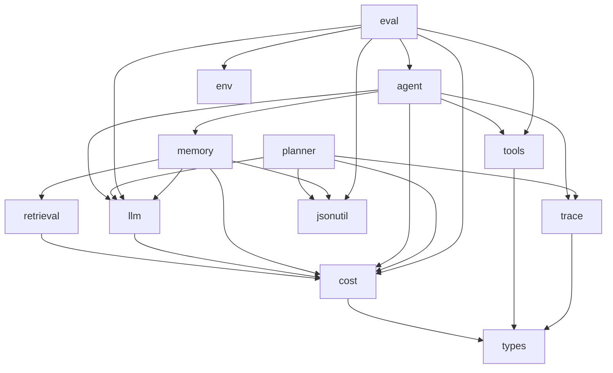

# Architecture

How Trellis is put together, why it is built this way, and what it does not do. Every statement
about behaviour was checked against the code at the time of writing; things that were considered but
are **not implemented** are marked "Not implemented". Measured results are in
[`EXPERIMENTS.md`](EXPERIMENTS.md), the evaluation and cost rules in [`EVAL.md`](EVAL.md).

## Module map

Arrows point from a module to the modules it imports at run time (`src/trellis_agent/`). There are
no cycles. `cost` mentions `llm.base.LLMResponse` only inside `if TYPE_CHECKING:`, so that edge
is not a run-time dependency, and `eval/scorers.py` does the same for `LLMClient`.

Every module also imports `types` (messages, `Usage`, `RunResult`, trace events). `planner` and `eval`
do not import each other: a `PlannedAgent` and a plain `Agent` both satisfy the harness's `Runnable`
protocol (`async arun(query, session_id=...) -> RunResult`), which is what lets the two be compared on
one task set. `experiments/` (outside `src/`) wires everything together for the studies.

| Package / module | Responsibility |
| --- | --- |
| `types` | `Message`, `ToolCall`, `Usage`, `RunResult`, `TraceEvent` |
| `llm` | `LLMClient` protocol, OpenAI-compatible client, scripted and rule-based mocks, hash embedder |
| `cost` | `PriceTable`, `CostMeter`, budgets, optional declared FX rates |
| `tools` | JSON Schema from type hints, argument validation, errors returned to the model |
| `trace` | structured events and aggregation |
| `agent` | the single tool-calling loop (`Agent.stream`) |
| `memory` | working window, episodic and semantic items, admission, supersession, consolidation, forgetting |
| `retrieval` | SQLite FTS5 BM25 index, jieba tokenizer, optional vector index, RRF fusion |
| `planner` | LLM planner, task graph validation, event-driven scheduler, retry policy, `PlannedAgent` |
| `eval` | task sets, scorers, runner, reports, baseline comparison, CLI |

## One task, input to output

For a plain `Agent` (`agent.py`, `Agent.stream`):

1. A tracer is created for the run and `run_start` is emitted.
2. If memory is attached, `memory.build_context` returns a working-window view of the session history
   plus an optional system note of retrieved memories. A failure here is traced and the run goes on
   without memory.
3. Loop up to `max_steps` (default 8): call `llm.chat` with the messages and tool schemas. A reply
   without tool calls ends the run (`end_turn`). Otherwise each tool call is executed by the
   `ToolRegistry` and its result, error or not, is appended as a tool message.
4. If memory is attached and the run did not stop on the budget, `memory.observe` stores the turn and
   extracts facts. A failure is traced, never raised.
5. The full history is kept in the in-memory session; `run_end` is emitted and a `RunResult` is
   yielded as the final `done` event.

Failures (provider error, budget, `max_steps`) are reported in `RunResult.error` and
`stop_reason`; they are not raised, so one bad run cannot take down an evaluation or a scheduler.
`arun` and `run` just collect the event stream. The events are step events (tool call, tool result,
final text); there is no token-by-token streaming.

For a `PlannedAgent` (`planner/planned.py`): the `Planner` asks the model for a task graph and
validates it; the `Scheduler` runs the tasks on worker agents chosen by task kind; a synthesiser call
writes the final answer from the task results. Cost and usage of planning attempts, repairs and
replans are included in the `RunResult`.

## Design decisions and trade-offs

**One event loop.** `Agent.stream` is the only loop implementation. Non-streaming use collects the
events. The reason is that parallel implementations of a loop drift apart and each bug has to be
fixed in several places. Trade-off: a session is not safe for two concurrent turns (documented in
the class); different sessions are fine.

**Cost is recorded in the client layer, and unpriced use fails closed.** `OpenAICompatClient.chat`
books every response in the `CostMeter` right after the call, with a tag. If a budget is set and the
model has no price, `record` raises `UnpricedModelError` (the budget could not be enforced); if a
call's currency differs from the meter's and no FX rate was declared, it raises
`CurrencyMismatchError`. The honest limit: a budget is checked when a call is *recorded*, so the
call that crosses the line has already been paid for. It is booked first and then
`BudgetExceeded` is raised with the response attached, so its tokens and cost still show up in the
run and in reports. With concurrent work, calls already in flight can also finish past the cap. New
work is gated separately: the scheduler and the eval runner stop starting tasks once
`meter.exhausted`. The agent loop itself does not check before each call.

**Several currencies are kept apart.** A meter has one currency (the budget's, or the first priced
call's). `by_currency` always holds the native totals. A cost in another currency is added only
through an FX rate declared in the price file with a source and date, and every conversion used is
listed in `fx_applied`; no rate is built in, none is inferred, and without one it is an error. Sums
use `math.fsum` over the per-call costs, so a total does not depend on the order in which concurrent
calls finished.

**Event-driven scheduling, not batches.** `_Run.execute` waits for *any one* running task
(`asyncio.wait(..., FIRST_COMPLETED)`), records it, and immediately launches whatever became ready,
so a slot freed by a short task is refilled at once instead of waiting for a whole batch of slower
tasks. Failure handling is a policy (`skip_dependents`, `fail_fast`, `replan`); transient failures
are retried with exponential backoff and jitter, other failures are not retried (`retry.py`). The
scheduler is single process and in memory. The claim about the batch alternative comes from reading
another project's code; no timing experiment compared the two designs.

**A plan is untrusted input.** The planner parses the model's JSON and validates it: shape, unknown
or self dependencies, cycles, size limit, unknown worker kinds. All problems are collected in one
`GraphError` and sent back to the model so it can repair the plan in one round trip, up to
`max_repair_attempts` (default 2). Every attempt, including failed ones, is counted in usage and
cost. `replan` does the same for unfinished work after a failure.

**Tiered memory.** Per turn, `memory.observe` stores the turn text as an *episodic* item, then asks a
`FactExtractor` for facts. Admission rejects a fact that is too short, over the per-turn limit
(default 5), or a duplicate. A fact with a key replaces an older item with the same key (the old one
is marked superseded). Accepted facts become *semantic* items. Before a turn, `build_context`
searches, keeps only live (not superseded) **semantic** items, and ranks them by
`relevance + 0.5 * recency + 0.5 * importance` (recency halves every 14 days by default) before
adding the top `retrieve_k` as a system note. Raw episodic items are not searched until they are
consolidated. `consolidate` and `forget` exist on `MemoryManager`, but the agent does not call them
automatically, and the consolidation summary is a plain concatenation of the first 80 characters of
each episode (no model call); the studies did not run them. Forgetting deletes items whose
retention score (recency and importance, no query) is below a threshold, then the lowest beyond
`max_items`. The working window is a per-turn view: the full history is kept and the window only
decides what is sent.

**Hybrid retrieval.** The base is BM25 on SQLite FTS5 with Porter stemming; query terms are OR-ed.
If a vector index and embedder are given, the BM25 and vector rankings are fused with Reciprocal Rank
Fusion, `score = sum 1 / (60 + rank)`, which uses ranks only, so the two score scales need no
normalisation. Without a vector index the retriever is plain BM25. Only a deterministic hash embedder
ships; there is no real embedding client, and embedding cost is an estimate (characters / 4).

**Chinese tokenisation.** English words are lowercased; runs of Chinese characters are cut with jieba
in search mode, loaded lazily with a private tokenizer instance so a user dictionary does not leak
globally. jieba splits words it does not know (for example "单号" into "单" and "号"); domain terms
need a user dictionary.

**Mock-testable by construction.** The `LLMClient` protocol has scripted and rule-based mocks, so the
whole stack and the evaluation flow run offline and deterministically; the test suite blocks the
network. Mock results say nothing about real-model quality.

## Studied but not adopted

These come from reading another agent project; they solve real problems that this project's scope
does not have, so they were left out on purpose. None is implemented.

| Idea | What it solves | Why not here |
| --- | --- | --- |
| Verification gates | A task's output is published only if a verifier passes it | Needs a verifier per task type; the studies score final answers with deterministic rules instead |
| Persisted scheduling with leases and epoch fencing | A stale or zombie worker overwriting a newer result in a distributed setting | The scheduler is a single process with no persistence, so there is no second writer to fence |
| Event-sourced sessions (checkpoint, fork, replay, hash-chained storage) | Replayable, tamper-evident history across restarts | Sessions here are in-memory dicts; persistence was out of scope |

## Not implemented

| Feature | Status |
| --- | --- |
| Hooks (callbacks around model or tool calls) | Not implemented (only a trace sink) |
| Guardrails (input/output policy checks) | Not implemented |
| Handoff between agents | Not implemented (the planner assigns tasks to workers by kind; this is not a handoff) |
| Token-by-token streaming | Not implemented (`stream` yields step events) |
| Persistent conversation sessions | Not implemented (`Agent` keeps session history in a dict). A `MemoryStore` can be given a file path and is then a SQLite file, but the vector index is in-memory only and the studies used the default `:memory:` store |
| Automatic consolidation and forgetting | Not implemented (methods exist; nothing calls them) |
| Model-written consolidation summaries | Not implemented |
| Real embedding client | Not implemented (hash embedder only) |
| Tiered or discounted pricing, price updates from the web, built-in exchange rates | Not implemented |
| Per-task budgets, per-task timeouts | Not implemented (one shared meter) |
| Passing back `reasoning_content` | Not implemented (tokens are counted and reported; the content is not kept) |
| MCP tool servers | Not implemented |

## Known limitations

* The scheduler occupies a concurrency slot while a task waits to retry, and has only a global budget.
* The Porter stemmer maps `verify` and `verification` to different stems, so a search for one does
  not find the other (an `xfail` test records it).
* The token estimates for the working window count characters / 4 and under-count Chinese text.
* Facts are shared by everything using one `MemoryManager`; the session id is stored but not used to
  filter.
* A consolidated summary is not reconciled with later corrections.
* `RuleExtractor` is a toy; `LLMExtractor` costs tokens and can miss or invent facts.
* Experimental limits (one model, fictional tasks, small samples, window-size dependence) are in
  [`EXPERIMENTS.md`](EXPERIMENTS.md).

## Possible extensions

None of these is done; each is a candidate, not a promise.

* Tiered pricing and a cache-aware price model.
* Passing `reasoning_content` back to providers that expect it with tool results, and measuring the
  effect on answer quality.
* Per-task budgets.
* Test whether the planner helps when tool calls take much longer. In the fanout timing run the
  tools were in-process fakes with no delay, so the planner's parallel workers had little tool
  latency to hide.
* Memory on much longer conversations, where memory could be cheaper than sending the full history
  (not tested; on the short scripts used, full history was cheaper).
* A real embedding client, and paraphrased test questions for retrieval.
